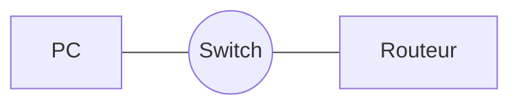

---
tags:
  - À venir        # ou : En cours / Terminé
  - Réseau         # le module
---

# Titre du cours

!!! abstract "En bref"
    2-3 lignes : ce qu'il faut retenir absolument.

## 1. Première notion

Ton texte ici. **Gras**, *italique*, listes :

- point 1
- point 2

| Colonne A | Colonne B |
|---|---|
| valeur | valeur |

## 2. Schéma



Ou une capture : mets l'image dans `docs/assets/images/` puis :
``

## 3. Commandes

```
Router# show ip interface brief
```

!!! warning "Piège"
    Un truc à ne pas oublier.

---

## Exercices

**Exercice 1** : l'énoncé.

??? success "Correction"
    La réponse (cachée tant qu'on ne clique pas).
