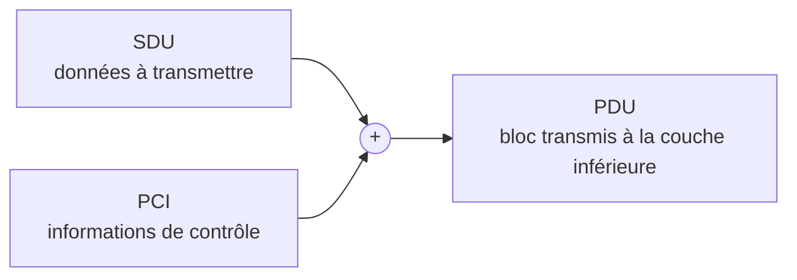
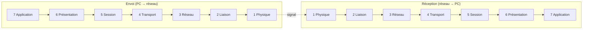

---
tags:
  - Base des réseaux
---

# Module 1 – Le modèle OSI

!!! abstract "En bref"
    - Le modèle **OSI** = 7 couches, chacune avec un rôle précis.
    - Chaque couche **encapsule** les données : SDU + PCI = PDU.
    - Envoi : couche **7 → 1**. Réception : couche **1 → 7**.

## 1. Définitions

| Terme | Définition |
|---|---|
| **OSI** (*Open Systems Interconnection*) | Norme qui définit **comment les communications se font** entre deux systèmes sur un réseau |
| **PDU** (*Protocol Data Unit*) | Unité de données **échangée entre deux entités réseau** sur une couche donnée. Chaque couche a son propre PDU |
| **SDU** (*Service Data Unit*) | Unité de données fournie par une couche à l'autre : les **données brutes** à transmettre |
| **PCI** (*Protocol Control Information*) | Informations **ajoutées** aux données pour contrôler leur transmission entre les couches |

## 2. L'encapsulation

Chaque fois qu'une couche reçoit des données de la couche supérieure, elle les **encapsule** dans un PDU en ajoutant des informations propres à son rôle (adresse, contrôle d'erreur…).

À la réception, chaque couche retire ses informations : c'est la **désencapsulation**.

## 3. Les 7 couches

| N° | Couche | Rôle | Exemples |
|---|---|---|---|
| 7 | **Application** | Là où les applications discutent avec le réseau | Navigateur web (HTTP/HTTPS), mail (SMTP, IMAP), SSH, FTP |
| 6 | **Présentation** | Convertit les données pour qu'elles soient compréhensibles | Chiffrement (SSL/TLS), compression, conversion de formats |
| 5 | **Session** | Gère les connexions entre appareils : ouverture, maintien, fermeture | Authentification SSH, session web |
| 4 | **Transport** | TCP et UDP | **TCP** : fiable, vérifie que tout est reçu (web, mail) · **UDP** : rapide mais pas fiable (jeux, streaming) |
| 3 | **Réseau** | Adresses IP, routage, passerelles | IP, ICMP (ping), routeurs |
| 2 | **Liaison** | Ce qui touche aux équipements locaux | Adresse MAC, VLAN, commutation (switch) |
| 1 | **Physique** | Câbles, Wi-Fi, signaux électriques | RJ45, fibre, ondes Wi-Fi |

**À toi de jouer** : clique sur une couche, ou lance l'envoi / la réception.

## 4. Le modèle TCP/IP (le modèle « du terrain »)

| Couche TCP/IP | Équivalent OSI |
|---|---|
| Application | 7, 6, 5 |
| Transport | 4 |
| Internet | 3 |
| Accès réseau | 2 et 1 |

## 5. Exemple : ouvrir google.com

| Étape | Couche | Ce qui se passe |
|---|---|---|
| 1 | Application | Firefox → HTTP/HTTPS |
| 2 | Transport | TCP, port **443** (HTTPS) |
| 3 | Réseau | IP source → IP destination, recherche du chemin (**routage**) |
| 4 | Liaison | MAC source → MAC destination locale (switch) |
| 5 | Physique | Signal sur RJ45 / Wi-Fi |

**L'encapsulation pas à pas** :

## 6. Le routage expliqué simplement

**Routage** = le routeur choisit un chemin pour atteindre **un autre réseau**.

Exemple : PC1 `192.168.1.10` et PC2 `192.168.2.10` sont sur deux réseaux différents → ils passent par la **passerelle**.

!!! tip "Règle d'or"
    - Un **routeur** connecte des **réseaux différents**.
    - Un **switch** connecte des appareils du **même réseau**.

---

## Exercices

**Exercice 1** : cite les 7 couches dans l'ordre, de 7 à 1.

??? success "Correction"
    7 Application · 6 Présentation · 5 Session · 4 Transport · 3 Réseau · 2 Liaison · 1 Physique

**Exercice 2** : complète : SDU + … = …

??? success "Correction"
    SDU + **PCI** = **PDU** (le bloc transmis à la couche inférieure).

**Exercice 3** : à quelle couche OSI se trouvent : l'adresse MAC, TCP, l'adresse IP, le chiffrement TLS, le câble RJ45 ?

??? success "Correction"
    MAC → 2 · TCP → 4 · IP → 3 · TLS → 6 · RJ45 → 1

**Exercice 4** : TCP ou UDP pour un jeu en ligne ? Pour un mail ?

??? success "Correction"
    Jeu → **UDP** (rapide). Mail → **TCP** (fiable, vérifie que tout est reçu).

**Exercice 5** : à quelles couches OSI correspond la couche « Application » de TCP/IP ?

??? success "Correction"
    Aux couches **7, 6 et 5**.

**Exercice 6** : `192.168.1.10` veut joindre `192.168.2.10`. Switch ou routeur ?

??? success "Correction"
    Deux réseaux différents → **routeur** (via la passerelle).

**TP Packet Tracer** (dans `C2- Bases des Réseaux\Module 1`) :

- [ ] `M01-01-TP-Packet-Tracer_Modele_OSI.pka`
- [ ] `M01-02-TP-Packet-Tracer_Modele_OSI.pka`
