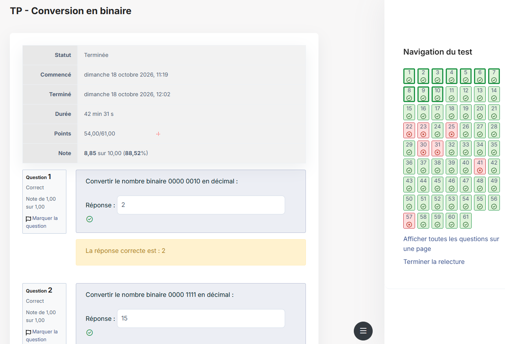

---
tags:
  - Base des réseaux
---

# Module 2 – Les unités informatiques

!!! abstract "En bref"
    - **1 octet = 8 bits**, valeurs des bits : 128 64 32 16 8 4 2 1.
    - Binaire → décimal : **addition** des valeurs des bits à 1.
    - Décimal → binaire : **divisions par 2**, on lit les restes **à l'envers**.

## 1. Les bases de numération

| Base | Chiffres | Utilisation |
|---|---|---|
| **Décimale** (10) | 0 à 9 | Notre système habituel |
| **Binaire** (2) | 0 et 1 | Représenter les données dans les ordinateurs |
| **Octale** (8) | 0 à 7 | Notamment les **permissions Linux** |
| **Hexadécimale** (16) | 0 à 9 et A à F | Adresses **MAC** et **IPv6** |

En hexadécimal : A = 10 · B = 11 · C = 12 · D = 13 · E = 14 · F = 15.

## 2. Binaire → décimal : addition

Valeur des 8 bits d'un octet (chaque bit vaut le double du précédent) :

| 128 | 64 | 32 | 16 | 8 | 4 | 2 | 1 |
|---|---|---|---|---|---|---|---|
| 0 | 0 | 0 | 0 | 1 | 0 | 1 | 0 |

On additionne les valeurs au-dessus des **1** : 8 + 2 = **10** → `0000 1010` = 10.

## 3. Décimal → binaire : division par 2

Exemple avec **35** : on divise par 2 et on garde le reste.

| Division | Résultat | Reste |
|---|---|---|
| 35 ÷ 2 | 17 | **1** |
| 17 ÷ 2 | 8 | **1** |
| 8 ÷ 2 | 4 | **0** |
| 4 ÷ 2 | 2 | **0** |
| 2 ÷ 2 | 1 | **0** |
| 1 ÷ 2 | 0 | **1** |

On lit les restes **à l'envers** (de bas en haut) : 35 = **100011**.

## 4. Récapitulatif des conversions

| Conversion | Méthode |
|---|---|
| Décimal → Binaire | Division par 2 |
| Décimal → Octal | Division par 8 |
| Décimal → Hexadécimal | Division par 16 |
| Binaire → Décimal | Addition des puissances de 2 |
| Octal → Décimal | Addition des puissances de 8 |
| Hexadécimal → Décimal | Addition des puissances de 16 |

---

## Exercices

**TP – Conversion en binaire** (quiz du campus, 54/61) :

**Exercice 1** : convertis `0000 0010` en décimal.

??? success "Correction"
    **2**

**Exercice 2** : convertis `0000 1111` en décimal.

??? success "Correction"
    **15** (8 + 4 + 2 + 1)

**Exercice 3** : convertis `1100 0000` en décimal.

??? success "Correction"
    128 + 64 = **192**

**Exercice 4** : convertis **22** en binaire.

??? success "Correction"
    22÷2 = 11 r**0** · 11÷2 = 5 r**1** · 5÷2 = 2 r**1** · 2÷2 = 1 r**0** · 1÷2 = 0 r**1** → à l'envers : **10110**

**Exercice 5** : combien vaut `F` en décimal ? Et `1A` ?

??? success "Correction"
    F = **15** · 1A = 1×16 + 10 = **26**

**Exercice 6** : quelle base sert pour les permissions Linux ? Pour les adresses MAC ?

??? success "Correction"
    Permissions Linux → **octale** · MAC → **hexadécimale**

*Ajoute ici les questions que tu avais ratées (22, 23, 25, 30, 31, 41, 57) pour les retravailler.*
