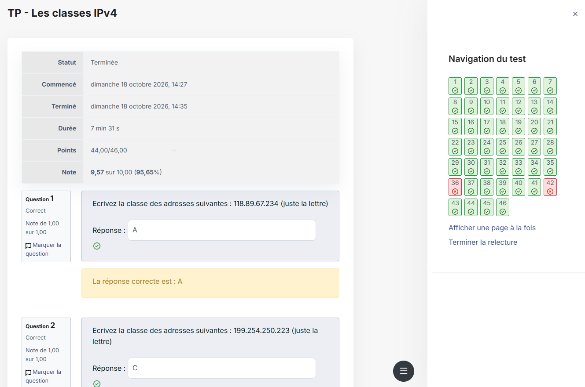
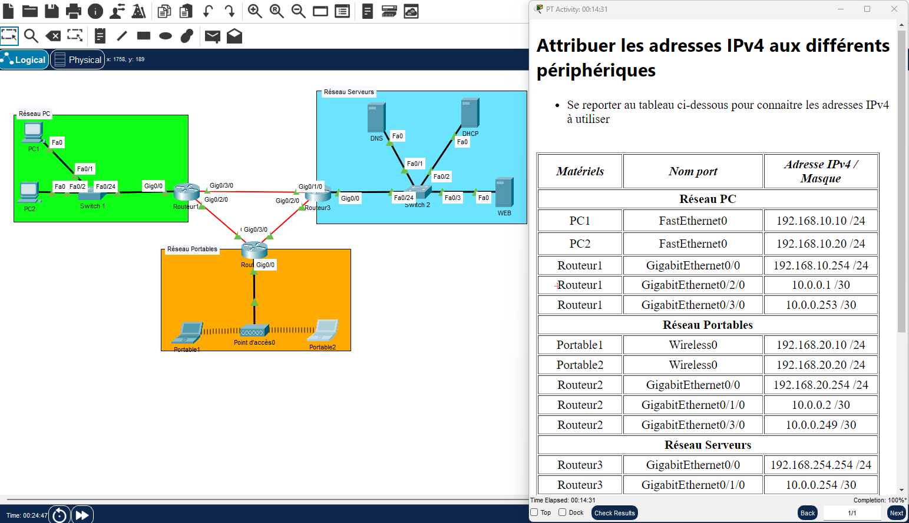

---
tags:
  - Base des réseaux
---

# Module 3 – L'adressage IPv4

!!! abstract "En bref"
    Adresse IPv4 = 32 bits en 4 octets = **identifiant réseau + identifiant hôte**, séparés par le **masque**.
    @réseau = bits hôte à **0** · @diffusion = bits hôte à **1** · **nb d'hôtes = 2ⁿ − 2** (n = bits hôte).

## 1. L'adressage logique

- Une adresse **IPv4** = **32 bits** découpés en **4 octets** distincts (1 octet = 8 bits).
- Elle est composée d'un **identifiant réseau** et d'un **identifiant hôte**, unique sur le réseau logique.
- Pour communiquer, un hôte a besoin d'une **adresse IP** et d'un **masque de sous-réseau**.
- À partir des deux, il calcule son **adresse de réseau** et son **adresse de diffusion**.

| Pour obtenir… | On passe… |
|---|---|
| L'adresse de **réseau** | tous les bits de l'ID **hôte à 0** |
| L'adresse de **diffusion** (broadcast) | tous les bits de l'ID **hôte à 1** (8 bits à 1 = 255) |
| Le **masque** | tous les bits de l'ID **réseau à 1** |
| Le **nombre d'hôtes** | 2^(nb de bits de l'ID hôte) **− 2** |

## 2. Les classes

| Classe | Type | 1ers bits | 1er octet | Masque | CIDR | Nb d'hôtes |
|---|---|---|---|---|---|---|
| A | Unicast | `0` | 1 – 126 | 255.0.0.0 | /8 | 2²⁴ − 2 = 16 777 214 |
| B | Unicast | `10` | 128 – 191 | 255.255.0.0 | /16 | 2¹⁶ − 2 = 65 534 |
| C | Unicast | `110` | 192 – 223 | 255.255.255.0 | /24 | 2⁸ − 2 = 254 |
| D | Multicast | `1110` | 224 – 239 | 240.0.0.0 | /4 | pas d'hôtes (adressage de groupe) |

{ loading=lazy }

## 3. La notation CIDR

**CIDR** (*Classless Inter-Domain Routing*) indique **combien de bits** sont réservés à la partie réseau. Elle remplace l'écriture du masque.
Exemple : `192.168.1.10/24` → les **24 premiers bits** identifient le réseau.

**Masque → CIDR** : on compte les bits à 1.
`255.255.248.0` → 255 + 255 = 16 bits, 248 = `1111 1000` = 5 bits → **/21**.

**CIDR → masque** : on fait l'inverse (binaire → décimal).

## 4. Calculer l'adresse réseau et l'adresse de diffusion

1. Convertir le CIDR en masque.
2. **256 − valeur de l'octet « intéressant »** du masque = **taille du bloc**.
3. Diviser l'octet correspondant de l'IP par la taille du bloc, garder l'**entier**.
4. Entier × taille du bloc = **début du bloc** (adresse réseau).
5. **Fin du bloc = début + taille du bloc − 1** (adresse de diffusion).

!!! example "11.107.56.23/20"
    Masque 255.255.**240**.0 → 256 − 240 = **16** · 56 ÷ 16 = 3,5 → 3 × 16 = **48**
    **Réseau : 11.107.48.0**

!!! example "194.224.199.234/19"
    Masque 255.255.**224**.0 → 256 − 224 = **32** · 199 ÷ 32 = 6,21 → 6 × 32 = **192** · 192 + 32 − 1 = **223**
    **Diffusion : 194.224.223.255**

!!! tip "Astuce"
    Tout ce qui suit l'octet intéressant vaut **0** pour l'adresse réseau et **255** pour l'adresse de diffusion.

## 5. Adresses privées, NAT et APIPA

| | Classe A | Classe B | Classe C |
|---|---|---|---|
| Plage globale | 10.0.0.0 – 10.255.255.255 | 172.16.0.0 – 172.31.255.255 | 192.168.0.0 – 192.168.255.255 |
| Plage utilisable | 10.0.0.1 – 10.255.255.254 | 172.16.0.1 – 172.31.255.254 | 192.168.0.1 – 192.168.255.254 |
| Masque | 255.0.0.0 | 255.240.0.0 | 255.255.0.0 |
| CIDR | 10.0.0.0/8 | 172.16.0.0/12 | 192.168.0.0/16 |

- **Pourquoi ?** Éviter l'épuisement rapide de l'espace d'adressage IPv4.
- Elles sont **non routables sur Internet** et **inaccessibles depuis l'extérieur** → elles passent par le **NAT**.
- **NAT** (*Network Address Translation*) : traduit les IP privées en **une IP publique unique** assignée au réseau.
- **APIPA** (*Automatic Private IP Addressing*) : IP automatique utilisée **quand le DHCP ne répond pas** (169.254.0.0/16).

!!! warning "APIPA"
    Avec une adresse APIPA : **pas d'accès Internet**, communication en local seulement.

## 6. Le sous-réseautage (subnetting)

- Le **masque** détermine comment on découpe le réseau.
- **Sous-réseautage** : modifier le masque pour séparer un réseau en plusieurs réseaux.
- **Subnetting** = **emprunter des bits à la partie hôte** en modifiant le masque.
- Nombre de bits à emprunter : **2^(bits empruntés)** doit couvrir le nombre de sous-réseaux demandés.

| CIDR | Masque (dernier octet) | Taille du bloc | Hôtes |
|---|---|---|---|
| /25 | .128 | 128 | 126 |
| /26 | .192 | 64 | 62 |
| /27 | .224 | 32 | 30 |
| /28 | .240 | 16 | 14 |
| /29 | .248 | 8 | 6 |
| /30 | .252 | 4 | 2 (liaison point à point) |

Exemples (TP CIDR) : `164.2.34.35/27` → réseau **164.2.34.32**, **30** hôtes, diffusion **164.2.34.63** · `210.222.5.121/29` → **210.222.5.120**, **6** hôtes, **210.222.5.127** · `11.107.56.23/20` → **11.107.48.0**, **4094** hôtes.

!!! warning "Adresse valide pour un hôte ?"
    Elle ne doit être **ni l'adresse réseau ni l'adresse de diffusion** de son sous-réseau.

## 7. Packet Tracer : attribuer les adresses

{ loading=lazy }

Fichiers : `M03-05-TP-Packet-Tracer_Adressage_IPv4.pka` (et ta version terminée `M03-05-TP-Términé.pka`).

---

## Exercices

**Exercice 0** : trouve l'adresse réseau et l'adresse de diffusion de `172.20.77.5/18`.

??? success "Correction"
    Masque 255.255.**192**.0 → bloc 64 · 77 ÷ 64 = 1 → **172.20.64.0** · 64 + 64 − 1 = 127 → **172.20.127.255**

**Exercice 0 bis** : `172.20.5.1` est-elle privée ? Et `172.40.5.1` ?

??? success "Correction"
    172.20.5.1 → **oui** (172.16 à 172.31) · 172.40.5.1 → **non**

### A. Validité des adresses (TP sous-réseaux)

**Exercice 1** : `209.207.177.100 /30` est-elle valide pour un hôte ?

??? success "Correction"
    **Non** : c'est l'adresse **réseau** (209.207.177.100 – .103, masque 255.255.255.252).

**Exercice 2** : `192.0.35.12 /26` ? Donne réseau, diffusion et masque.

??? success "Correction"
    **Oui**. Réseau 192.0.35.0, diffusion 192.0.35.63, masque 255.255.255.192.

**Exercice 3** : `120.80.1.0 /11` ?

??? success "Correction"
    **Oui** (le .0 n'est pas forcément l'adresse réseau !). Réseau 120.64.0.0, diffusion 120.95.255.255, masque 255.224.0.0.

**Exercice 4** : `172.16.0.127 /25` et `192.168.19.87 /29` ?

??? success "Correction"
    **Non** pour les deux : ce sont des adresses de **diffusion** (172.16.0.0–.127 et 192.168.19.80–.87).

**Exercice 5** : `109.168.248.32 /21` ?

??? success "Correction"
    **Oui**. Réseau 109.168.248.0, diffusion 109.168.255.255, masque 255.255.248.0.

### B. Calcul de masque (à partir du masque de classe)

**Exercice 6** : trouve le CIDR pour : au moins 120 sous-réseaux dans 172.16.0.0 · liaisons point à point dans 192.168.1.0 · exactement 8 sous-réseaux dans 192.168.10.0 · environ 2020 sous-réseaux dans 10.0.0.0.

??? success "Correction"
    - 172.16.0.0 **/23** (7 bits → 128 sous-réseaux)
    - 192.168.1.0 **/30** (2 hôtes)
    - 192.168.10.0 **/27** (3 bits → 8)
    - 10.0.0.0 **/19** (11 bits → 2048)

**Exercice 7** : 10 sous-réseaux d'au moins 17 hôtes dans 214.12.33.0 /24 : possible ?

??? success "Correction"
    **Non** : 10 sous-réseaux = 4 bits, il ne reste que 4 bits hôte → 14 hôtes max.

### C. Scénarios

**Exercice 8** : réseau 128.199.0.0, 1 500 hôtes par segment max. Quel masque ? Combien de sous-réseaux et d'hôtes ?

??? success "Correction"
    1 500 hôtes → 11 bits hôte → masque **255.255.252.0** (selon la correction : 6 bits empruntés → **64** sous-réseaux, **1022** adresses par segment).

**Exercice 9** : réseau 39.0.0.0, 88 000 hôtes par segment.

??? success "Correction"
    17 bits hôte nécessaires → masque **255.255.0.0** → **256** sous-réseaux de **65 534** adresses (selon la correction).

### D. Découpage (VLSM)

**Exercice 10** : découpe 199.210.15.0 /24 en 1 bloc /25, 1 /26, 1 /27 et 4 /29 (ordre croissant).

??? success "Correction"
    199.210.15.0/25 · .128/26 · .192/27 · .224/29 · .232/29 · .240/29 · .248/29

**Exercice 11** : 222.8.15.0 /24 : 1 segment d'une centaine d'hôtes + 4 segments de 28 hôtes.

??? success "Correction"
    222.8.15.0/25 (126 hôtes) puis 222.8.15.128/27, .160/27, .192/27, .224/27 (30 hôtes chacun).

**Exercice 12** : 192.168.10.0 /24 : 3 segments d'une soixantaine d'hôtes, 1 d'une trentaine, 2 d'au moins 11.

??? success "Correction"
    .0/26, .64/26, .128/26 · .192/27 · .224/28, .240/28

### E. Sous-réseaux inutilisés

**Exercice 13** : dans 192.168.10.0/24, sont utilisés .0/25, .128/27, .160/27, .224/28. Que reste-t-il ?

??? success "Correction"
    **192.168.10.192/27** et **192.168.10.240/28**.

**Exercice 14** : dans 112.19.0.0/16 sont utilisés 0/18, 64/18, 128/19, 160/20, 176/20, 224/20, 240/20. Que reste-t-il ?

??? success "Correction"
    **112.19.192.0/19** (de .192.0 à .223.255).

**Exercice 15** : dans 199.1.1.0/24 sont utilisés .0/26, .128/27, .160/27, .192/28, .224/28, .240/28.

??? success "Correction"
    **199.1.1.64/26** et **199.1.1.208/28**.
