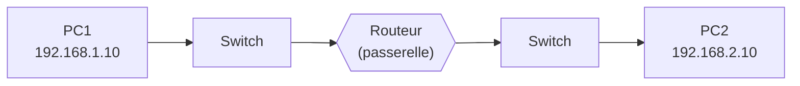
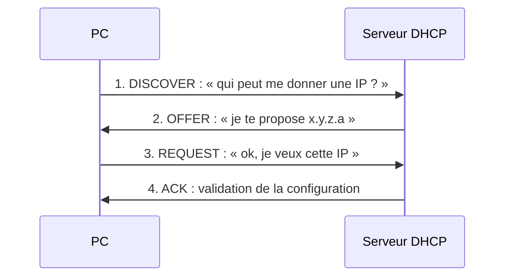

---
tags:
  - Base des réseaux
---

# Module 4 – La communication

!!! abstract "En bref"
    - Un **switch** propage les broadcasts dans son VLAN, un **routeur** sépare les domaines de diffusion.
    - Le **routeur** lit l'IP de destination, consulte sa **table de routage** et choisit où envoyer le paquet.
    - Subnetting = **séparation** · Supernetting = **regroupement**.

## 1. Le domaine de diffusion (broadcast)

- **Domaine de diffusion** : ensemble d'appareils qui reçoivent les messages envoyés en broadcast.
- **Broadcast** : message envoyé à **tous les appareils** d'un même domaine de diffusion.

| | Adresse de broadcast | Couche OSI |
|---|---|---|
| MAC | `FF:FF:FF:FF:FF:FF` | 2 – Liaison |
| IP | tous les bits de la partie hôte à 1 (ex. `192.168.1.255` en /24) | 3 – Réseau |

Utilisé notamment par **ARP** (recherche d'une adresse MAC) et **DHCP** (obtention d'une adresse IP).

| Équipement | Comportement |
|---|---|
| **Switch** | Transmet les broadcasts aux équipements du **même VLAN** |
| **Routeur** | **Sépare** les domaines de diffusion, ne transmet pas les broadcasts IPv4 d'un réseau à l'autre |
| **VLAN** | Chaque VLAN = un domaine de diffusion distinct |

**Pourquoi les séparer ?** Réduire le trafic inutile, améliorer les performances, mieux isoler les parties du réseau.

## 2. Le routage

- **Routage** : déterminer le **chemin** que doivent emprunter les paquets IP pour atteindre leur destination. Couche **3**.
- **Rôle du routeur** (communiquer entre réseaux différents) : il lit l'**IP de destination**, consulte sa **table de routage**, choisit où envoyer le paquet.
- **Table de routage** : liste des routes connues. Elle contient le **réseau de destination**, la **passerelle** (ou prochain routeur) et l'**interface de sortie**.

| Type de routage | Routes |
|---|---|
| **Statique** | Configurées **manuellement** |
| **Dynamique** | Apprises et mises à jour **automatiquement** grâce à des protocoles (RIP, OSPF, BGP) |

**Passerelle par défaut** : routeur auquel un appareil envoie les paquets destinés à un **autre réseau**, quand il ne peut pas les atteindre directement.

## 3. Le sur-réseau (supernetting)

- **Supernetting** : regrouper plusieurs sous-réseaux en **un seul réseau plus grand**.
- **À quoi ça sert ?** Réduire le nombre de routes dans les tables, simplifier la gestion, optimiser le routage.
- **Comment ?** On regroupe des réseaux **contigus** (qui se suivent) avec un préfixe CIDR **plus petit**.
- **Conditions** : les réseaux se suivent **sans interruption** et sont **correctement alignés**.

!!! example "Exemple"
    Avant : 192.168.0.0/24, 192.168.1.0/24, 192.168.2.0/24, 192.168.3.0/24
    Après : **192.168.0.0/22** → 4 réseaux de 256 adresses = 1 024 adresses.

## 4. ARP

**ARP** (*Address Resolution Protocol*) : trouve l'**adresse MAC** correspondant à une **adresse IP** sur un réseau local.

| Action | Windows | Linux |
|---|---|---|
| Afficher la table ARP (IP/MAC) | `arp -a` | `arp -a` |
| Vider le cache | `arp -d *` | `sudo ip neigh flush all` |
| Ajouter une association IP/MAC statique | `arp -s IP MAC` | `sudo arp -s IP MAC` |

## 5. DHCP et DNS

**DHCP** (*Dynamic Host Configuration Protocol*) : service qui donne **automatiquement** une configuration réseau aux appareils (adresse IP, masque, passerelle, DNS). Sans lui, tout se configure à la main : ingérable sur 50, 200 ou 2 000 machines.

**DNS** (*Domain Name System*) : traduit un **nom** (ex. `youtube.com`) en **adresse IP**. Internet ne fonctionne qu'en IP, mais on ne peut pas retenir des dizaines d'adresses. Le PC demande au DNS l'IP de youtube.com, le DNS répond par l'IP.

## 6. Communiquer dans un même segment

Chaque poste raisonne avec **son** masque. Sur le même câble, deux postes ne dialoguent que si chacun voit l'autre dans son réseau logique.

Exemple du TP : A `172.16.10.10/16` et F `172.16.10.200/24`
→ A voit F dans 172.16.0.0/16 ✔ · F voit A dans 172.16.10.0/24 ✔ → **dialogue possible**.
Mais B `172.16.11.20/16` et F : B voit F (172.16.0.0/16) mais F ne voit pas B (pas dans 172.16.10.0/24) → **pas de réponse**.

## 7. Communiquer entre réseaux : la passerelle

- Destination hors de son réseau → l'hôte envoie à sa **passerelle** (qui doit être **dans son réseau**)
- Une passerelle mal configurée (hors réseau) = pas de communication vers l'extérieur
- La réponse doit aussi pouvoir revenir (passerelle correcte chez le destinataire)

## 8. Les tables de routage

Chaque routeur connaît ses réseaux **directement connectés** ; pour les autres, on ajoute des **routes statiques** `(réseau, masque, routeur suivant)`, en **agrégeant** au maximum pour en mettre le moins possible.

## 9. Résumé de routes (agrégation)

On cherche les bits communs à tous les réseaux :

| Réseaux | Résumé |
|---|---|
| 212.56.132.0/24 → 212.56.135.0/24 (4 réseaux) | **212.56.132.0/22** |
| 212.56.146.0/24 → 212.56.149.0/24 | **212.56.144.0/21** |
| Tous les réseaux de classe A | **0.0.0.0/1** |
| Tous les réseaux de classe B | **128.0.0.0/2** |
| Tous les réseaux de classe C | **192.0.0.0/3** |

## 10. TP Packet Tracer

`M04-01-02-TP-Packet_Tracer-La_communication.pka` : mettre en place la communication inter-réseaux en suivant les directives. Voir aussi [TP – Passerelle par défaut](tp-passerelle-packet-tracer.md).

---

## Exercices

**Exercice 1** : même segment, sans routeur. A `172.16.10.10/16`, B `172.16.11.20/16`, C `172.16.100.30/16`, D `172.16.11.100/24`, E `172.16.100.150/24`, F `172.16.10.200/24`. Qui peut dialoguer avec qui ?

??? success "Correction"
    | Hôte | Dialogue avec |
    |---|---|
    | A | B, C, F |
    | B | A, C, D |
    | C | A, B, E |
    | D | B |
    | E | C |
    | F | A |

    Les /16 se voient tous entre eux ; chaque /24 ne voit que le /16 qui est dans son propre /24.

**Exercice 2** : A `10.11.2.1/8` GW 10.0.0.254 et B `192.168.1.35/8` GW 10.0.0.254. A peut-il envoyer à B ?

??? success "Correction"
    **Non** : avec son masque /8, B est dans 192.0.0.0/8 et sa passerelle 10.0.0.254 n'est pas dans son réseau ; il ne peut pas répondre. (Tableau du TP : A → B = F.)

**Exercice 3** : agrège 212.56.132.0/24, .133, .134 et .135.

??? success "Correction"
    **212.56.132.0/22** (132 = 1000 0100, les 4 réseaux partagent les 22 premiers bits).

**Exercice 4** : quel résumé couvre tous les réseaux de classe B ?

??? success "Correction"
    **128.0.0.0/2** (tous les 1ers octets qui commencent par `10` en binaire).

**Exercice 5** : regroupe 10.1.4.0/24, 10.1.5.0/24, 10.1.6.0/24 et 10.1.7.0/24.

??? success "Correction"
    **10.1.4.0/22** (4 réseaux contigus et alignés : 4 est un multiple de 4).

**Exercice 6** : dans quel ordre se passe un échange DHCP ?

??? success "Correction"
    **D**iscover → **O**ffer → **R**equest → **A**ck (DORA).

**Exercice 7** : un routeur transmet-il un broadcast IPv4 vers un autre réseau ?

??? success "Correction"
    **Non** : le routeur sépare les domaines de diffusion.

**Exercice 8** : quelle commande Windows affiche la table ARP ?

??? success "Correction"
    `arp -a`

**Exercice 9** : le bloc 131.107.0.0/16 est découpé en 9 segments reliés par R1 à R8. Quelles routes minimales sur R1 ?

??? success "Correction"
    Selon la correction : `x.107.32.0/19 → R2`, `x.107.64.0/18 → R2`, `x.107.128.0/17 → R2` (on agrège tout ce qui est derrière R2).
