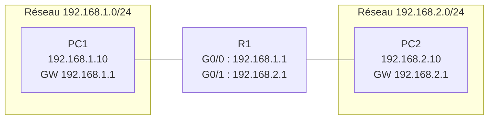

---
tags:
  - Base des réseaux
---

# TP – Passerelle par défaut sous Packet Tracer

!!! example "Page d'exemple"
    Contenu d'exemple écrit pour montrer le rendu : remplace-le par ton cours.

!!! abstract "En bref"
    La **passerelle par défaut** est l'adresse IP du routeur, **dans le même réseau que le PC**.
    Sans elle, un PC ne peut parler qu'aux machines de son propre réseau.

## 1. Le principe

Quand un PC veut joindre une IP :

1. Il compare l'IP de destination à **son réseau** (grâce au masque).
2. Même réseau → il envoie directement.
3. Réseau différent → il envoie le paquet à **sa passerelle**, qui se charge de router.

## 2. Schéma de la maquette



!!! tip "Ajouter une capture"
    Tu peux remplacer ou compléter ce schéma par une capture de ta maquette :
    mets l'image dans `docs/assets/images/` puis écris
    ``

## 3. Configuration

=== "PC (Desktop → IP Configuration)"

    | Champ | PC1 | PC2 |
    |---|---|---|
    | IPv4 Address | 192.168.1.10 | 192.168.2.10 |
    | Subnet Mask | 255.255.255.0 | 255.255.255.0 |
    | Default Gateway | **192.168.1.1** | **192.168.2.1** |

=== "Routeur R1 (CLI)"

    ```
    Router> enable
    Router# configure terminal
    Router(config)# interface g0/0
    Router(config-if)# ip address 192.168.1.1 255.255.255.0
    Router(config-if)# no shutdown
    Router(config-if)# exit
    Router(config)# interface g0/1
    Router(config-if)# ip address 192.168.2.1 255.255.255.0
    Router(config-if)# no shutdown
    Router(config-if)# end
    Router# copy running-config startup-config
    ```

## 4. Vérifier

```
PC1> ping 192.168.1.1      # 1. je joins ma passerelle ?
PC1> ping 192.168.2.10     # 2. je joins l'autre réseau ?
Router# show ip interface brief   # interfaces "up/up" ?
```

## 5. Erreurs fréquentes

| Symptôme | Cause probable |
|---|---|
| Ping passerelle KO | Interface du routeur en `shutdown`, ou mauvaise IP/masque |
| Ping passerelle OK, autre réseau KO | Passerelle absente ou fausse sur le PC **d'en face** |
| Tout KO après redémarrage du routeur | Config pas sauvegardée (`copy run start`) |

---

## Exercices

**Exercice 1** : PC1 a l'IP `192.168.1.10/24` et la passerelle `192.168.2.1`. Peut-il joindre PC2 ?

??? success "Correction"
    Non. La passerelle doit être **dans le réseau du PC** (192.168.1.0/24). Il faut mettre `192.168.1.1`.

**Exercice 2** : PC1 ping sa passerelle, mais pas PC2. PC2 ping sa passerelle aussi. Où chercher ?

??? success "Correction"
    Vérifier la passerelle **configurée sur PC2** : le ping aller arrive, mais la réponse ne peut pas revenir si PC2 n'a pas (ou a une mauvaise) passerelle.

**Exercice 3 (pratique)** : refais la maquette dans Packet Tracer avec un 3ᵉ réseau `192.168.3.0/24` sur l'interface G0/2.

- [ ] Ajouter un PC3 et lui donner une IP + passerelle
- [ ] Configurer G0/2 sur R1
- [ ] Ping PC1 → PC3 OK
