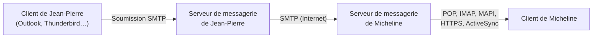

---
tags:
  - Microsoft 365 – Outils collaboratifs
---

# Module 4 – Exploiter Outlook et savoir le dépanner

!!! abstract "En bref"
    Un mail part du client en **soumission SMTP**, voyage de serveur à serveur en **SMTP**, et le destinataire le récupère en **POP / IMAP / MAPI / HTTPS / ActiveSync**.
    Outlook se configure tout seul grâce à l'**Autodiscover**. Dépannage : testconnectivity, journalisation, mode sans échec, refaire le profil, scanpst.

## 1. Le cheminement d'un mail

Comme une lettre : facteur → bureau de poste → centre de tri de Nantes → centre de tri de Rennes → bureau de poste → facteur → boîte aux lettres.

1. Jean-Pierre écrit son mail dans son logiciel
2. Son serveur récupère le mail dans la boîte d'envoi (**soumission SMTP**) et en garde une copie dans les éléments envoyés
3. Son serveur l'envoie au serveur de Micheline (**SMTP**)
4. Le client de Micheline télécharge ses mails depuis son serveur (**IMAP, POP, ActiveSync, HTTPS, MAPI**…)

### Ports à ouvrir sur le pare-feu

| Protocole | Non sécurisé | TLS/SSL |
|---|---|---|
| HTTP | 80 | 443 |
| POP3 (Post Office Protocol) | 110 | 995 |
| IMAP4 (Interactive Message Access Protocol) | 143 | 993 |
| SMTP (Simple Mail Transfer Protocol) | 25 | |
| Soumission client SMTP | 587 ou 2525 | (465 déprécié) |

**Quand utiliser quel protocole ?**

| Protocole | Usage |
|---|---|
| **SMTP** | **Envoyer** un mail depuis un client (Outlook, Thunderbird) et échanger entre serveurs de messagerie. Port 25 entre serveurs, 587 (STARTTLS) ou 465 (TLS) pour un client |
| **IMAP** | **Consulter et synchroniser** les mails : recommandé si on utilise **plusieurs appareils** par compte |
| **POP3** | **Télécharger** les mails sur **un seul appareil** : ils ne restent pas sur le serveur |
| **HTTP(S)** | Accéder à un **webmail** (Gmail, Outlook…) |

## 2. Installation et Autodiscover

Installer Outlook depuis `https://portal.office.com` puis paramétrer son compte.

**Autodiscover** = autoconfiguration d'Outlook en saisissant juste son adresse mail (depuis Outlook 2007 et Skype for Business) :

1. L'utilisateur entre son adresse mail
2. Outlook cherche et contacte le serveur de messagerie
3. Il envoie l'adresse SMTP pour obtenir les options de configuration
4. Il télécharge un fichier **.xml** avec les paramètres du serveur
5. Il se connecte à Exchange Online et reçoit ses mails

**Tester :** ++ctrl++ + clic droit sur l'icône Outlook (zone de notification) → *Tester la configuration automatique de la messagerie* et *État de la connexion*.

| Code HTTP | Sens |
|---|---|
| 1xx | Information |
| 2xx | Succès |
| 3xx | Redirection |
| 4xx | Erreur du client |
| 5xx | Erreur du serveur |

## 3. Les versions d'Outlook

| Outlook Online | Outlook 365 | Outlook 2019 |
|---|---|---|
| Dans un navigateur, connexion Internet nécessaire | À installer, dispo hors connexion (.ost) | À installer, dispo hors connexion (.ost) |
| Ne gère pas les comptes externes (Gmail, Yahoo!) | Payant avec l'offre Office de Microsoft 365 | Payant avec le pack Office |
| Ne prend pas en charge IMAP | Toutes les fonctionnalités, MAJ de fonctionnalités et sécurité | Fonctionnalités de sa version, MAJ de sécurité |

## 4. Utiliser Outlook

Outlook gère : **messagerie, rendez-vous, réunions, contacts, tâches**.
Interface : barre de titre, ruban, volet des dossiers, volet de lecture, volets calendrier / contacts / tâches, barre de navigation.

| Fonction | Rôle |
|---|---|
| **Outlook aujourd'hui** | Rendez-vous, nb de messages reçus, liste des tâches |
| **Affichage en conversation** | Regroupe les messages de même objet |
| **Réponse automatique** | Message envoyé pendant une absence |
| **Barre d'infos-courrier** | Disponibilité des destinataires à la rédaction |
| **Règles** | **Condition → Action (→ Exception)** pour ranger, prioriser… |
| **Rappel de message** | Supprimer les copies non lues (et éventuellement les remplacer) |

### Calendrier

| | |
|---|---|
| **Rendez-vous** | Bloque une plage horaire |
| **Réunion** | Invite des utilisateurs et des ressources (salles, matériel) |
| **Événement** | Ne bloque pas de temps, dure au moins la journée |
| **Groupes de calendriers** | Afficher / fusionner plusieurs calendriers |
| **Tâches** | Actions à mener, avec priorité et suivi |

### Autres éléments

- **Élément** = message, rendez-vous, tâche, réunion… · **Catégorie** = classer / prioriser (affectable par une règle)
- **Archivage** (automatique) quand la boîte aux lettres devient trop grosse

| Raccourci | Action |
|---|---|
| ++ctrl+shift+m++ | Nouveau message |
| ++alt+s++ | Envoyer |
| ++ctrl+shift+k++ | Nouvelle tâche |
| ++ctrl+e++ / ++f3++ | Rechercher |
| ++ctrl+2++ | Calendrier |
| ++ctrl+shift+a++ | Nouveau rendez-vous |
| ++ctrl+m++ / ++f9++ | Vérifier les nouveaux mails |

## 5. Dépanner Outlook

| Outil | Rôle |
|---|---|
| **testconnectivity.microsoft.com** | Tester les accès externes à l'infrastructure Exchange / Microsoft 365 |
| Outlook Online | Valider login / mot de passe |
| **Journalisation** (Fichier > Options > Options avancées) | Logs d'erreurs de connexion dans `%LOCALAPPDATA%\Temp\Journalisation d'Outlook` |
| **Mode hors connexion** | Diagnostiquer les problèmes de perf réseau, continuer en cas de coupure |
| **Mode sans échec** (`outlook.exe /safe`) | Démarrer sans les modules complémentaires |
| **Modules complémentaires** | Désactiver les inutiles / gourmands |
| **État de la connexion** (++ctrl++ + clic droit icône) | Comptes, serveurs, MailboxId |
| **Refaire le profil** | Outlook fermé : supprimer le profil (Panneau de config > Mail), relancer → Autodiscover |
| **SCANPST.EXE** | Analyser et réparer un .pst / .ost |
| `Test-OutlookConnectivity` | Tester **Outlook Anywhere** (accès Exchange Online depuis Internet sans VPN, activé par défaut) |

### Les fichiers .pst et .ost

| | |
|---|---|
| **.pst** (Personal Storage Table) | Données stockées **localement** (comptes POP3 / IMAP4 sans Exchange) |
| **.ost** (Offline Storage Table) | Copie **hors connexion** ; les données sont sur le serveur Exchange |
| Taille max (MaxFileSize) | **50 Go** |
| Seuil d'alerte (WarnFileSize) | **47,5 Go** |

!!! tip "En complément (tes notes)"
    - Penser à **compartimenter** un .pst dès **25 Go** occupés.
    - **SCANPST.EXE** se trouve dans `C:\Program Files (x86)\Microsoft Office\Office15` (selon la version d'Office) et **ne fonctionne pas toujours**.
    - Autre outil de réparation : `MicrosoftEasyFix20101.mini.diagcab` (résolution de problèmes classique Microsoft).
    - Performances : connaître le **nombre d'éléments** dans la messagerie (article Microsoft KB 2768656) → clic droit sur la boîte de réception > **Propriétés** > **Taille du dossier**.
    - Ne pas oublier de **désactiver la journalisation** une fois terminé : elle prend beaucoup de place sur le poste.

---

## Exercices

**Exercice 1** : quel protocole envoie un mail de serveur à serveur ? Lesquels servent à le récupérer ?

??? success "Correction"
    **SMTP** entre serveurs (soumission SMTP du client vers son serveur). Récupération : **POP, IMAP, MAPI, HTTPS, ActiveSync**.

**Exercice 2** : à quoi sert l'Autodiscover et comment le tester ?

??? success "Correction"
    Configurer Outlook automatiquement à partir de l'adresse mail (fichier XML de paramètres). Test : ++ctrl++ + clic droit sur l'icône Outlook > *Tester la configuration automatique de la messagerie*.

**Exercice 3 (TP 2)** : tu ouvres Outlook en mode sans échec. As-tu toujours les émojis ? Pourquoi ?

??? success "Correction"
    Non : `outlook.exe /safe` démarre **sans les modules complémentaires** (dont le complément Emojis).

**Exercice 4 (TP 2)** : tu refais le profil Outlook. Retrouves-tu tes mails, calendrier, tâches ?

??? success "Correction"
    Oui : avec Exchange, les données sont sur le **serveur**. L'Autodiscover reconfigure le profil et tout est re-téléchargé (le complément Emojis aussi, installé depuis Outlook sur le web).

**Exercice 5** : différence entre .pst et .ost ? Taille max ?

??? success "Correction"
    .pst = stockage **local** (POP/IMAP) ; .ost = copie **hors connexion** d'une boîte Exchange. Max **50 Go** (alerte à 47,5 Go). Réparation : **SCANPST.EXE**.

**Exercice 6 (TP 1)** : crée la règle « mon mail perso ».

??? success "Correction"
    **Condition** : message contenant « réponse automatique » dans le corps → **Actions** : déplacer dans « réponse congés » + catégorie verte « réponse auto » → nommer la règle, cocher *Exécuter cette règle sur les messages déjà présents*.
