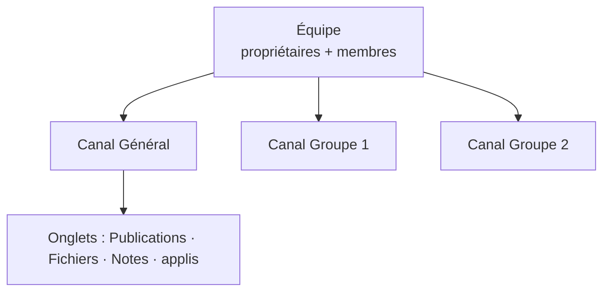

---
tags:
  - Microsoft 365 – Outils collaboratifs
---

# Module 5 – Exploiter Teams, SharePoint et OneDrive

!!! abstract "En bref"
    **SharePoint** = sites web internes et partage de documents. **OneDrive** = stockage cloud perso (1 To, service SharePoint Online).
    **Teams** = espace de travail centralisé : équipes → canaux → onglets. Versioning et co-édition partout.

## 1. SharePoint

Suite de logiciels pour créer des **sites web internes**.

| Version | |
|---|---|
| **SharePoint Online** | Hébergé dans le cloud Microsoft (abonnement Microsoft 365 ou autonome) |
| **SharePoint Server** | Installé en local (*on-premises*) |
| **SharePoint Designer** | Gratuit, gestion de flux de travail (Business Connectivity Services) |
| **Synchronisation OneDrive Entreprise** | Synchroniser des documents pour les utiliser hors connexion |

**À quoi ça sert :** partager et collaborer (documents, versioning), informer (Teams, blog, actualités), transformer les flux métier (ERP, logiciels tiers), gérer les connaissances (wiki d'entreprise), protéger les données (anti-malware).

## 2. OneDrive

- Stockage dans le cloud Azure, **1 To par défaut**, service de SharePoint Online
- Depuis PC, tablette, mobile : stocker, consulter, partager depuis n'importe quel ordinateur connecté
- Travail avec des utilisateurs internes ou externes, chiffrement avancé possible
- Accès : **portail Microsoft 365** ou **application** OneDrive

### Les icônes

| Icône | Sens |
|---|---|
| 3 tirets bleus | Nouveau fichier |
| Croix rouge | Ne peut pas être synchronisé |
| Nuage grisé | Non connecté au compte |
| Pause | Synchronisation en pause |
| Flèches circulaires | Synchronisation en cours |
| Nuage avec une personne | Fichier / dossier partagé |
| Nuage | Disponible **en ligne uniquement** |
| Cercle vert, coche verte | Fichier ouvert, téléchargé localement |
| Cercle vert plein, coche blanche | **Toujours** gardé localement |
| Cadenas | Des paramètres empêchent la synchro |

### Fonctionnalités

- **Partage** par lien ou par mail (date d'expiration, mot de passe, lecture seule…)
- **Corbeille** (restaurer un fichier) et **restauration de tout l'espace OneDrive**
- **Versioning** : historique des modifications, revenir à une version sans perdre la dernière
- **Co-édition** : travailler à plusieurs en même temps (curseur coloré de chaque co-auteur) sur **.docx, .pptx, .xlsx**, dans OneDrive, OneDrive Entreprise, SharePoint Online / Server
- **Paramètres du client** : choisir les dossiers à synchroniser, limiter les débits

## 3. Teams

Espace de travail centralisé : Office et autres applis en co-édition, **1 To** de stockage, audio / vidéo, partage d'écran, réunions planifiées, fil de conversation, enregistrement, calendrier, multiplateforme.
Interface en 3 volets : gauche, central, principal.

### Les limites à retenir

| | Max |
|---|---|
| Équipes créées par un utilisateur | 250 |
| Membres par équipe | 10 000 |
| Équipes dont un utilisateur est membre | 1 000 |
| Canaux par équipe | 200 |
| Participants à une réunion | 250 |
| Restauration d'un canal supprimé | 30 jours |

### Créer une équipe crée aussi…

- Un **groupe Microsoft 365**
- Un **site SharePoint Online**
- Une **boîte aux lettres partagée** (cachée par défaut dans Outlook)
- Un **bloc-notes OneNote**

**Paramètres d'équipe :** image, autorisations des membres et des invités, @mentions, code d'invitation, outils amusants (emojis, GIF…), balises (créées par le propriétaire par défaut).

### Canaux, onglets, fichiers, messages

- **Canal** : compartimente l'équipe par sujet, **privé ou public**, canal **Général** par défaut, notifications par canal ; on peut y envoyer un mail, ajouter des onglets, des connecteurs
- **Onglets** par défaut : **Publications, Fichiers, Notes** (+ applis)
- **Fichiers** : accessibles à tous les membres, stockés dans une **bibliothèque SharePoint par canal**, avec versioning et co-édition ; un fichier peut devenir un onglet
- **Messages** : publics (toute l'équipe / le canal) ou privés ; enregistrables ; appels audio/vidéo enregistrés dans **Stream**

### Les réunions

Planifiée ou immédiate, 250 participants max, créable depuis Outlook ; partage d'un PowerPoint, de l'écran ou d'un tableau blanc ; **salle d'attente**.

| Rôle | Droits |
|---|---|
| **Organisateur** | Tous les droits (a créé la réunion) |
| **Présentateur** | Gère la réunion et les participants, pas les rôles |
| **Participant** | Participe |

---

## Exercices

**Exercice 1** : quelle est la différence entre l'icône « nuage » et « cercle vert plein » dans OneDrive ?

??? success "Correction"
    Nuage = fichier **en ligne uniquement** ; cercle vert plein (coche blanche) = **toujours** conservé sur l'appareil.

**Exercice 2** : quand tu crées une équipe Teams, quels éléments sont créés automatiquement ?

??? success "Correction"
    Un **groupe Microsoft 365**, un **site SharePoint Online**, une **boîte aux lettres partagée** et un **bloc-notes OneNote**.

**Exercice 3** : où sont stockés les fichiers d'un canal Teams ?

??? success "Correction"
    Dans une **bibliothèque SharePoint** créée pour chaque canal.

**Exercice 4** : sur quels formats la co-édition est-elle prise en charge ?

??? success "Correction"
    **.docx, .pptx, .xlsx**.

**Exercice 5 (TP OneDrive)** : partage « recette du pain perdu » avec expiration au lendemain et mot de passe, modifie-le, puis reviens à la version précédente.

??? success "Correction"
    - Sélectionner le fichier > **Partager** > « Toute personne disposant du lien » > date d'expiration + mot de passe > message > Envoyer
    - Ouvrir dans l'application de bureau, modifier, fermer
    - **…** > **Historique des versions** > **Restaurer** la version voulue

**Exercice 6** : partage le fichier en **lecture seule** depuis l'explorateur Windows.

??? success "Correction"
    Clic droit sur le fichier (dossier OneDrive) > Partager > paramètres du lien > décocher **Autoriser la modification**.
