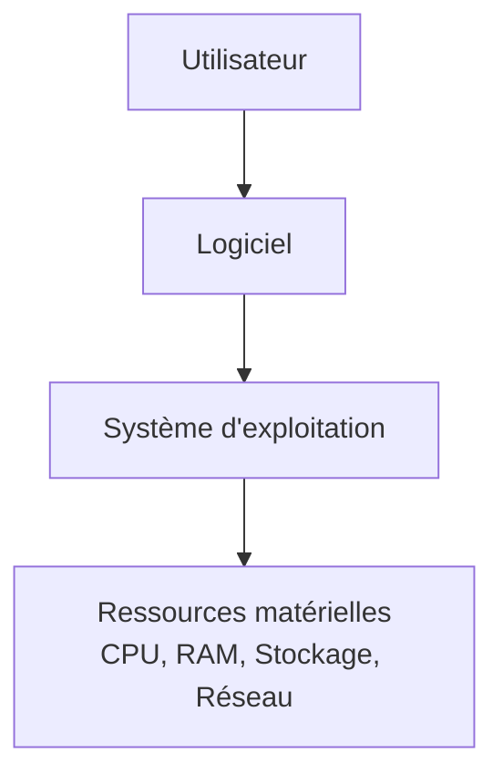

---
tags:
  - Systèmes clients Microsoft
---

# Module 1 – Les systèmes d'exploitation et Microsoft Windows 10

!!! abstract "En bref"
    Un OS pilote le matériel et reçoit les instructions de l'utilisateur ou des logiciels.
    Windows 10 est prédominant en entreprise : un technicien doit le connaître.

## 1. Définition et fonctions d'un OS

Un **système d'exploitation** (Operating System, OS) est un logiciel qui pilote les dispositifs matériels et reçoit des instructions de l'utilisateur ou d'autres logiciels (applications).

**Fonctions principales :**

- Gérer les processeurs et la mémoire vive
- Optimiser l'exécution des applications en leur attribuant les ressources nécessaires
- Fournir des informations sur le bon fonctionnement de l'ordinateur
- Utiliser les périphériques dans les meilleures conditions
- Protéger l'accès aux ressources

## 2. Composition et place aujourd'hui

| Composant | |
|---|---|
| Noyau | *kernel* |
| Interpréteur de commandes | CLI ou *shell* |
| Interface graphique | GUI (facultative) |
| Système de fichiers | *file system* |

On trouve des OS partout : serveurs / postes, smartphones / tablettes, montres connectées, switchs / routeurs / box / NAS / imprimantes, télévisions, véhicules…

## 3. Les OS Windows

MS-DOS (1981) → Win 1 → Win NT (1993) → Win 95 → Win 98 (1998) → Win 2000 → XP (2001) → Vista (2007) → 7 (2009) → 8 (2012) → **10 (juillet 2015)**

| Système | Sortie | Fin des ventes | Fin support standard | Fin support étendu |
|---|---|---|---|---|
| XP | Oct. 2001 | Juin 2008 | Avr. 2009 | Avr. 2014 |
| Vista | Janv. 2007 | Oct. 2011 | Avr. 2012 | Avr. 2017 |
| 7 | Oct. 2009 | Oct. 2013 | Janv. 2015 | Janv. 2020 |
| 8 | Oct. 2012 | Oct. 2016 | Janv. 2018 | Janv. 2023 |
| 10 | Juil. 2015 | * | * | * |

\* Chaque build Windows 10 possède sa propre date de fin de support.

| Vocabulaire | Sens |
|---|---|
| **KB** (Knowledge Base) | Correctif de sécurité / fonctionnalité |
| **SP** (Service Pack) | Ensemble de KB |
| **Release** | Mise à jour majeure de l'OS (ex. Windows 8.1) |

## 4. Windows as a Service (WaaS)

| Terme | Définition |
|---|---|
| Windows Insider | Communauté d'utilisateurs bêta-testeurs de Windows 10 |
| Build | Version de Windows 10 identifiée par un numéro (ex. **1903** = mars 2019), avec son lot de fonctionnalités. **Support de 18 mois** |
| Feature updates | Nouvelle build : **2 par an** (majeure au printemps, mineure à l'automne) |
| Quality updates | Patchs de sécurité, correctifs de bugs : **2ᵉ mardi du mois** (*Patch Tuesday*) |

**Canal semi-annuel :** 1903 → 1909 → 2004 → 2009… (feature update entre chaque build, quality updates en continu).

## 5. Éditions et licences Windows 10

| Édition | Particularités |
|---|---|
| **Famille** | Usage exclusivement domestique (Cortana, bureaux supplémentaires, OneDrive, Edge…) |
| **Professionnelle** | Obligatoire pour intégrer une infrastructure Microsoft : jonction au domaine, traitement des GPO, chiffrement EFS, BitLocker / BitLocker To Go, démarrage natif sur VHD |
| **Entreprise** | En plus : AppLocker, Windows To Go, DirectAccess, BranchCache |

| Licence | Signification | Définition |
|---|---|---|
| **OEM** | Original Equipment Manufacturer | Préinstallée, liée à la machine |
| **Retail** | Vente au détail | Liée à l'utilisateur, s'installe sur un poste |
| **MAK** | Multiple Activation Key | Une licence pour plusieurs postes clients |
| **VLK** | Volume Licence Key | Déploiement des clients ; nécessite le service **KMS** et plus de 25 postes |
| **CAL** | Client Access Licence | Permet au client de solliciter le service d'un serveur Microsoft |

---

## Exercices

**Exercice 1** : cite les 4 composants d'un système d'exploitation.

??? success "Correction"
    Noyau (kernel), interpréteur de commandes (CLI / shell), interface graphique (GUI, facultative), système de fichiers.

**Exercice 2** : quelle édition minimale de Windows 10 faut-il pour joindre un domaine et appliquer des GPO ?

??? success "Correction"
    **Professionnelle** (la Famille est réservée à l'usage domestique).

**Exercice 3** : que veut dire la build « 1903 » et combien de temps est-elle supportée ?

??? success "Correction"
    Build sortie en **mars 2019** (19 = année, 03 = mois), supportée **18 mois**.

**Exercice 4** : quelle licence est liée à la machine ? Laquelle nécessite un serveur KMS ?

??? success "Correction"
    **OEM** est liée à la machine. **VLK** nécessite KMS (et plus de 25 postes).
