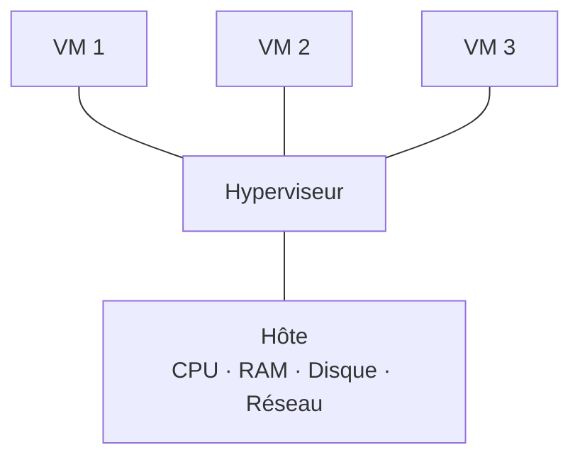

---
tags:
  - Systèmes clients Microsoft
---

# Module additionnel – VMware Workstation

!!! abstract "En bref"
    La virtualisation fait cohabiter plusieurs systèmes invités isolés sur les ressources d'un ordinateur physique (l'hôte).
    Workstation permet de maquetter pour apprendre ou tester avant la production : c'est l'outil majeur de la formation.

## 1. La virtualisation des systèmes

| Élément | Rôle |
|---|---|
| **Hôte** | Ordinateur physique (serveur ou PC), possède les ressources |
| **Système invité (VM)** | Ordinateur virtuel avec son propre OS ; utilise les ressources de l'hôte ; défini par un ensemble de fichiers dans un répertoire d'accueil ; géré par l'hyperviseur |
| **Hyperviseur** | Indispensable : lien entre l'hôte et les VM (logiciel ou OS). Gère, partage et priorise l'accès aux ressources de l'hôte |

Une VM a les mêmes besoins qu'un PC : **processeur, RAM, disque, carte réseau** (+ lecteur DVD / stockage externe, carte graphique / son, firmware).

## 2. Workstation et les ressources

| Ressource | Dans Workstation |
|---|---|
| Processeur | Attribution des ressources CPU |
| Mémoire vive | Attribuée au démarrage de la VM, configurable |
| Disque dur | **C'est un fichier !** Taille dynamique, taille maximale configurable |

## 3. Workstation et le réseau

La VM doit être connectée à un **switch virtuel** pour communiquer (VM de son réseau, autres réseaux, hôte, machines physiques, Internet).

| Switch virtuel | Fonctionnement |
|---|---|
| **Host-Only** | VM ↔ hôte uniquement (carte *VMware Network Adapter VMnet1*) |
| **VMnet / LAN Segment** | Réseaux isolés entre VM (un routeur virtuel peut relier plusieurs segments) |
| **Bridge** | La VM est directement sur le réseau physique (accès Internet) |
| **NAT** | La VM sort via l'adresse de l'hôte (translation d'adresse, *VMnet8*) |

## 4. Les spécificités de Workstation

| Avantages | Inconvénients |
|---|---|
| IHM épurée, simple | Prévu pour des maquettes simples |
| Pause, snapshots, clonage | Logiciel propriétaire VMware |
| Dossiers partagés hôte / VM | Temps d'adaptation aux notions (virtualisation OS, stockage, réseau) |
| Glisser-déposer… grâce aux **VMware Tools** | |

!!! tip "À connaître"
    - Séquence de démarrage paramétrable dans le BIOS de la VM ; CD/DVD, USB, disquette gérés
    - La VM capture clavier et souris : ++ctrl+alt++ pour reprendre la main
    - ++ctrl+alt+del++ dans la VM : taper ++ctrl+alt+insert++

## 5. Import / export de VM

| Action | Comment |
|---|---|
| **Importer** | Ouvrir une VM depuis son dossier d'accueil, ou importer une archive **.ovf / .ova** |
| **Exporter** | Copier son dossier d'accueil, ou exporter en **.ovf / .ova** |

---

## Exercices

**Exercice 1** : quel mode réseau choisir pour une VM qui doit seulement communiquer avec l'hôte ?

??? success "Correction"
    **Host-Only**.

**Exercice 2** : quelle est la différence entre Bridge et NAT ?

??? success "Correction"
    **Bridge** : la VM est directement sur le réseau physique, comme une machine à part entière.
    **NAT** : la VM sort en utilisant l'adresse de l'hôte (translation d'adresse via VMnet8).

**Exercice 3** : comment envoyer ++ctrl+alt+del++ à une VM ?

??? success "Correction"
    ++ctrl+alt+insert++ (ou le bouton dédié dans Workstation).

**Exercice 4** : sous quels formats exporter une VM ?

??? success "Correction"
    **.ovf** ou **.ova** (ou copie du dossier d'accueil).
