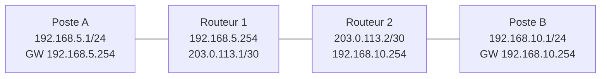

---
tags:
  - Systèmes clients Microsoft
---

# Module 7 – La gestion du réseau et du pare-feu

!!! abstract "En bref"
    Tout poste client doit communiquer sur les réseaux de l'entreprise : configurer la carte, **tester et diagnostiquer** (`ipconfig`, `ping`, `tracert`, `nslookup`), puis **ouvrir/fermer des accès** avec le pare-feu.

## 1. Rappel : communication entre deux réseaux

1. A voit que B n'est pas dans son réseau → il envoie à sa **passerelle** (MAC trouvée dans son **cache ARP**)
2. Chaque routeur désencapsule la trame, lit l'**IP de destination**, consulte sa **table de routage** et réencapsule vers le saut suivant
3. Le dernier routeur (directement connecté à 192.168.10.0) trouve la MAC de B et lui remet la trame

Les **adresses IP** source/destination restent les mêmes ; les **adresses MAC** changent à chaque saut.

## 2. Configuration de la carte réseau

**Centre Réseau et partage** (icône réseau > Paramètres réseau et Internet, ou Panneau de configuration > Réseau et Internet) :

- Infos : connectivité, connexions détectées, profils et emplacements réseau
- Paramètres : partage (découverte, partages, dossiers publics), **cartes réseau** (`ncpa.cpl`), nouvelles connexions

### L'emplacement réseau

Chaque carte est associée à un emplacement qui **détermine le comportement du pare-feu** :

| Emplacement | Quand |
|---|---|
| **Privé** | Poste autonome |
| **Domaine** | Poste joint à un domaine (non modifiable) |
| **Public** | Pas de passerelle, domaine non détecté, ordinateur non visible sur le réseau… |

### Les paramètres IP

- Adresse IP + masque, **passerelle**, serveurs **DNS** préféré et auxiliaire
- **Statique** : configuré à la main
- **Dynamique** : fourni par un serveur **DHCP**, ou **APIPA**

!!! info "APIPA"
    Si aucun serveur DHCP n'est joignable, Windows s'attribue une adresse en **169.254.0.0/16** : communication temporaire, **réseau local uniquement**.

### Les outils

| Outil | Rôle |
|---|---|
| Zone de notification, Connexions réseau, Assistant de résolution | Graphique, orienté utilisateur |
| `ipconfig` | Afficher la config, agir sur la pile réseau (DNS, DHCP) |
| `ping` | Tester la connectivité (**bloqué par défaut par le pare-feu Windows !**) |
| `tracert` | Voir la route empruntée par les paquets |
| `nslookup` | Diagnostiquer la résolution de noms |

Les outils en ligne de commande sont les plus précis et efficaces.

## 3. Le pare-feu Windows

**Pourquoi :** délimiter les flux autorisés en entrée / sortie, protéger le poste contre les accès non autorisés, appliquer la stratégie de sécurité de l'entreprise.

**Caractéristiques :**

- **Activé par défaut** : bloque certains flux **entrants**, autorise **tous** les flux **sortants**
- Règles prédéfinies activées (ou faciles à activer)
- S'adapte à l'emplacement réseau du poste
- Administrable de façon centralisée (stratégies, export)

| Niveau | Outil |
|---|---|
| **Utilisateur** | *Vérifier l'état du pare-feu* : activer / désactiver (`firewall.cpl`) |
| **Programme** | *Autoriser une application via le pare-feu Windows* : règles génériques par profil |
| **Avancé** | Console *Pare-feu Windows Defender avec fonctions avancées de sécurité* : toutes les règles en détail |

---

## Exercices

**Exercice 1** : un poste a l'adresse 169.254.12.4. Que s'est-il passé ? Que peut-il faire ?

??? success "Correction"
    Adresse **APIPA** : aucun serveur DHCP joignable. Il ne peut communiquer que sur le **réseau local**.

**Exercice 2** : ping vers la passerelle et Discovery = 1 saut, vers facebook.com = plusieurs sauts. Pourquoi ?

??? success "Correction"
    La passerelle et Discovery sont sur le **même réseau local** (communication directe). Facebook est sur un **autre réseau** : le paquet traverse des routeurs grâce à la passerelle par défaut. `tracert` montre chaque saut.

**Exercice 3** : à quoi sert `nslookup www.facebook.com` ?

??? success "Correction"
    Interroger le **DNS** pour obtenir l'adresse IP d'un nom (on voit aussi quel serveur DNS répond, et les alias éventuels).

**Exercice 4 (TP)** : autorise le Bureau à distance seulement sur le profil privé, puis autorise le ping entrant.

??? success "Correction"
    - *Autoriser une application via le pare-feu Windows* → cocher **Bureau à distance** pour **Privé**
    - Console avancée > Règles de trafic entrant → activer **Partage de fichiers et d'imprimantes (Demande d'écho – Trafic entrant ICMPv4)**

**Exercice 5 (TP)** : configure une IP fixe (masque 255.255.0.0, passerelle et DNS de ton réseau) sur ta VM.

??? success "Correction"
    `ncpa.cpl` > clic droit sur la carte > Propriétés > **TCP/IPv4** > Propriétés > *Utiliser l'adresse IP suivante* : IP, masque, passerelle, DNS préféré. Vérifier avec `ipconfig /all` puis `ping`.
