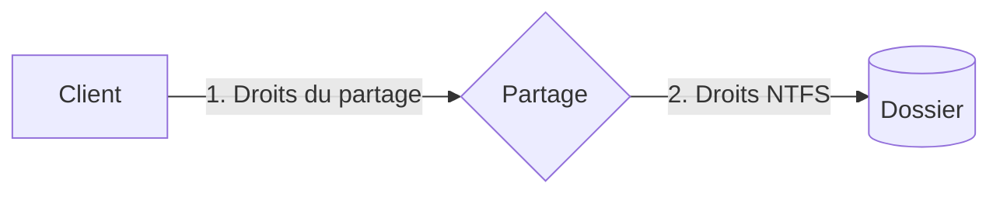

---
tags:
  - Systèmes clients Microsoft
---

# Module 8 – Le partage de ressources

!!! abstract "En bref"
    Un partage donne accès à une ressource hébergée par un serveur, depuis un client, à travers le réseau.
    **Double vérification : droits du partage PUIS droits NTFS** — le plus restrictif gagne.
    Le Bureau à distance (RDP, port 3389) donne accès à un poste à distance.

## 1. Les principes du partage

| | Exemples |
|---|---|
| **Ressources** | Fichiers (dossier, arborescence, volume), imprimantes |
| **Serveurs** | Tout système connecté : serveur, poste fixe/portable, copieur, tablette, smartphone… |
| **Clients** | Tout système connecté peut accéder aux ressources partagées |

- **Qui peut partager ?** Il faut des **droits administratifs** (partager = modifier le système)
- **Qui a accès ?** Authentification requise (compte local ou de domaine)
- **3 niveaux** sur le partage : **Lecture, Modifier, Contrôle total**
- **2 vérifications** : 1) au niveau du **partage**, 2) au niveau des droits **NTFS** → les autorisations du partage sont **restrictives**



## 2. Accéder à un partage

| Méthode | Exemple |
|---|---|
| Momentané : chemin **UNC** dans l'explorateur | `\\serveur\partage` |
| Durable : **Connecter un lecteur réseau** | Mémorisé avec le profil utilisateur |
| cmd | `net use z: \\serveur\partage` · `net view` liste les partages |
| PowerShell | `New-SmbMapping -LocalPath 'R:' -RemotePath '\\SRV-FIC\Compta'` |

## 3. Créer un partage

- **Explorateur** : partage de base (simplifié, orienté utilisateur, **à éviter**) ou **partage avancé** (onglet Partage des propriétés)
- Par défaut **Tout le monde** est en Lecture → **bonne pratique : remplacer par Utilisateurs authentifiés**
- **Console Dossiers partagés** (`fsmgmt.msc`) : partages actifs, assistant de création, sessions et fichiers ouverts, **partages administratifs** du système (C$, ADMIN$…)

```
net share commun=d:\Note_de_service /grant:"utilisateurs authentifiés",FULL
```

```powershell
New-SmbShare -Name "VMSFiles" -Path "C:\ClusterStorage\Volume1\VMFiles" -FullAccess "Authenticated Users"
Get-SmbShare                 # lister les partages
Get-SmbShareAccess N$        # qui accède à un partage
```

## 4. Le Bureau à distance

- Accès distant avec un compte valide (local ou domaine) et des privilèges spécifiques ; même fonctionnement qu'une session locale
- **Usages** : maintenir des postes, administrer des serveurs, accéder à son environnement depuis l'extérieur (VPN)

| Limites | |
|---|---|
| Poste client | **1 seule session** (locale ou distante) : pas d'interaction avec l'utilisateur |
| Serveur | **2 sessions simultanées** (depuis 2008), avec des comptes différents |
| | Blocage si les sessions restent ouvertes |

**Se connecter :** outil *Connexion Bureau à distance* (onglets de personnalisation, sauvegarde des paramètres, **mappage des ressources locales**) ou `mstsc /v:serveur`.

**Configurer le poste cible :** Panneau de config > Système > Paramètres système avancés > onglet **Utilisation à distance** (`sysdm.cpl`)

- **Désactivé par défaut** ; accès autorisé par défaut aux **administrateurs**
- 2 niveaux d'authentification : **standard** ou **NLA**
- Protocole **RDP, port 3389**, pare-feu configuré automatiquement (attention aux emplacements réseau)

---

## Exercices

**Exercice 1** : le partage donne *Contrôle total* aux Utilisateurs authentifiés, NTFS donne *Lecture* au groupe Utilisateurs. Que peut faire un utilisateur standard ?

??? success "Correction"
    **Lecture** seulement : les deux vérifications s'appliquent et c'est la plus restrictive qui gagne.

**Exercice 2 (TP)** : partage `D:\Echange` en `CoWorkerShare` avec les bonnes pratiques, modifiable par tes collègues.

??? success "Correction"
    1. Propriétés > Partage > **Partage avancé** > nom `CoWorkerShare`
    2. Autorisations : supprimer **Tout le monde**, ajouter **Utilisateurs authentifiés** en **Contrôle total**
    3. Onglet **Sécurité** (NTFS) : `L_Collegues` en **Modification**
    4. Tester depuis l'autre VM : `\\<IP>\CoWorkerShare`

**Exercice 3 (PowerShell)** : quel dossier est partagé par `ADMIN$` ? Qui accède à `N$` ?

??? success "Correction"
    `Get-SmbShare ADMIN$` → **C:\Windows** (partage administratif natif).
    `Get-SmbShareAccess N$` → **Administrateurs**, **Opérateurs de sauvegarde** et **INTERACTIF** en Contrôle total.

**Exercice 4 (TP)** : permets à deux utilisateurs d'ouvrir une session RDP sur Discovery. Une fois connectée, une utilisatrice standard peut-elle changer le mot de passe d'un autre ?

??? success "Correction"
    `sysdm.cpl` > Utilisation à distance > *Autoriser les connexions à distance* + **Sélectionner des utilisateurs**.
    Non : seuls les **Administrateurs** peuvent changer le mot de passe d'un autre compte (adm le peut, et peut aussi ouvrir une session RDP par défaut).

**Exercice 5** : connecte durablement le partage `\\serveur\partage` sur Z: en cmd.

??? success "Correction"
    `net use z: \\serveur\partage`
