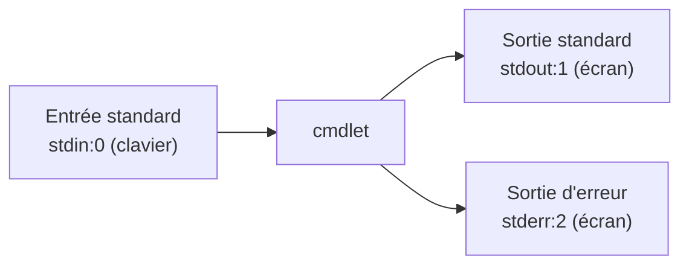

---
tags:
  - Systèmes clients Microsoft
---

# Module 11 – Plus loin avec PowerShell

!!! abstract "En bref"
    **Rediriger** les flux (`>`, `>>`, `2>`), **enchaîner** avec le pipeline `|`, **filtrer** avec `Where-Object`,
    **sélectionner** avec `Select`, et **formater en dernier** (`Format-List / Table / Wide`).

## 1. La redirection de flux



| Syntaxe | Effet |
|---|---|
| `cmdlet > fichier` (ou `1>`) | Sortie standard → fichier (écrase) |
| `cmdlet >> fichier` (ou `1>>`) | Sortie standard → **fin** du fichier |
| `cmdlet 2> fichier.err` | Erreurs → fichier |
| `cmdlet 2>> fichier.err` | Erreurs → fin du fichier |
| `cmdlet > fichier 2>&1` | Sortie **et** erreurs → fichier |
| `cmdlet 2>$null` | Erreurs « dans le vide » |

```powershell
Get-LocalUser > C:\temp\LocalUserList.txt
Get-Content C:\temp\LocalUserList.txt
```

## 2. Le pipeline

Le pipeline `|` transmet la sortie standard d'une cmdlet à l'entrée standard de la suivante (enchaînement possible).

```powershell
Get-NetAdapter | Select Name,Status,LinkSpeed
```

## 3. Le filtrage

**Opérateurs de comparaison** (insensibles à la casse par défaut, préfixe `c` pour les rendre sensibles) — aide : `Get-Help about_Comparison_Operators`

| Comparaison | Insensible | Sensible |
|---|---|---|
| Égal | `-eq` | `-ceq` |
| Différent | `-ne` | `-cne` |
| Supérieur | `-gt` | `-cgt` |
| Supérieur ou égal | `-ge` | `-cge` |
| Inférieur | `-lt` | `-clt` |
| Inférieur ou égal | `-le` | `-cle` |
| Ressemble à (joker `*`) | `-like` | `-clike` |
| Ne ressemble pas | `-notlike` | `-cnotlike` |

=== "Filtrage basique (1 propriété)"

    ```powershell
    Get-NetAdapter | Select Name,Status,LinkSpeed | Where Status -like Up
    ```

=== "Filtrage avancé (plusieurs propriétés)"

    `-FilterScript { }` + la variable **`$_`** (ou `$PSItem`) = l'objet en cours.

    ```powershell
    Get-NetAdapter | Select Name,Status,LinkSpeed |
      Where -FilterScript { $_.Status -like "Up" -and $_.LinkSpeed -gt "100 Mbps" }
    ```

## 4. Le formatage

PowerShell formate par défaut. Les `Format-*` se mettent **en dernier**, « après avoir terminé le travail ».

| Cmdlet | Alias | Exemple |
|---|---|---|
| `Format-List` | `FL` | `Get-Service | FL -Property Name,Status,DisplayName` |
| `Format-Table` | `FT` | `Get-TimeZone | FT -Property StandardName,BaseUtcOffset -AutoSize` |
| `Format-Wide` | `FW` | `Get-Process | FW -Property ID -Column 5` (une seule propriété, sur plusieurs colonnes) |

`-Property *` affiche toutes les propriétés.

!!! tip "Méthode du TP"
    `Get-Command` pour trouver la cmdlet → `Get-Help` pour l'utiliser → `Select` pour les propriétés demandées → `Where` pour les valeurs → `Format-*` si demandé.

---

## Exercices

**Exercice 1** : affiche la date du jour, puis le numéro du jour dans l'année.

??? success "Correction"
    `Get-Date` puis `Get-Date | Select DayOfYear`

**Exercice 2** : affiche les événements 4624 du journal Security avec seulement EventID, date et message.

??? success "Correction"
    ```powershell
    Get-EventLog -LogName Security | Where EventID -eq 4624 | Select EventID,TimeWritten,Message
    ```

**Exercice 3** : règles de pare-feu activées : nom, profil, direction, action.

??? success "Correction"
    ```powershell
    Get-NetFirewallRule | Where Enabled -like 'True' | Select DisplayName,Profile,Direction,Action
    ```

**Exercice 4** : volumes avec plus de 8 Go **libres** et une taille max de 25 Go, en liste (nom, lettre, FS).

??? success "Correction"
    ```powershell
    Get-Volume | Where -FilterScript { $_.SizeRemaining -gt 8GB -and $_.Size -lt 25GB } |
      FL FileSystemLabel,DriveLetter,FileSystemType
    ```
    Attention : l'espace **libre** c'est `SizeRemaining`, pas `Size`.

**Exercice 5** : services démarrés **et** en démarrage automatique (nom et statut).

??? success "Correction"
    ```powershell
    Get-Service | Where -FilterScript { $_.Status -like "Running" -and $_.StartType -like "Automatic" } | Select Name,Status
    ```

**Exercice 6** : nom et chemin des partages administratifs.

??? success "Correction"
    `Get-SmbShare | Select Name,Path | Where Name -like *$`

**Exercice 7** : redirige les erreurs d'une commande dans le vide, puis sortie + erreurs dans `log.txt`.

??? success "Correction"
    `cmdlet 2>$null` · `cmdlet > log.txt 2>&1`
