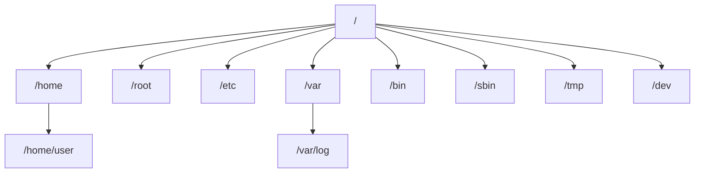
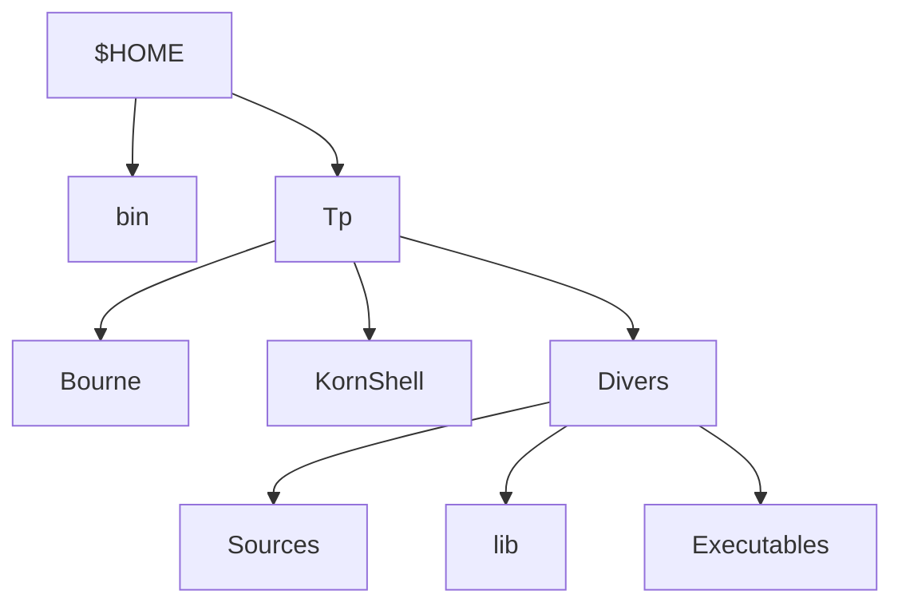

---
tags:
  - Utilisation d'une distribution GNU/Linux
---

# Module 4 – Fichiers et dossiers sous Linux

!!! abstract "En bref"
    - Le répertoire personnel est dans **`$HOME`**.
    - `cd` pour se déplacer, `cd ..` pour remonter, `.` = le répertoire actuel.
    - Le **FHS** standardise l'arborescence : `/home`, `/etc`, `/var/log`, `/bin`…
    - Dossiers : `mkdir` / `rmdir` (vides seulement) · fichiers : `touch`, `mv`, `cp`, `rm` · lister : `ls -l -a -h -d -r -t`.
    - Métacaractères : `*` (n'importe quoi), `?` (un seul caractère), `[...]` (un caractère de la liste), `[!...]` (sauf).
    - Expressions `?() *() +() @() !()` : activer d'abord **`shopt -s extglob`**.

## 1. Arborescence de fichiers : les chemins

- Le chemin du **répertoire personnel** d'un utilisateur est contenu dans la variable **`$HOME`**.
- **Chemin relatif** : part de **là où l'on se trouve**.

| Commande | Rôle |
|---|---|
| `cd` | Se déplacer dans les dossiers, un à un ou en écrivant le chemin complet |
| `cd ..` | Remonter au dossier précédent (enchaînable pour remonter plusieurs dossiers : `cd ../..`) |
| `.` | Le répertoire actuel : pour lancer un script (`./monscript.sh`) ou le préciser (`find . -name "*.txt"`) |

## 2. Arborescence de fichiers : le FHS

**FHS** (*Filesystem Hierarchy Standard*) : standardisation de l'arborescence Unix/Linux.

| Dossier | Contenu |
|---|---|
| `/home` | Dossiers de tous les utilisateurs, **sauf root** |
| `/root` | Répertoire de l'utilisateur root |
| `/media` | Pour connecter des médias (CD, USB) |
| `/mnt` | Pour connecter des partitions de disques |
| `/bin` | Commandes pour les utilisateurs |
| `/sbin` | Commandes pour root (super-admin) |
| `/opt` | Programmes installés manuellement |
| `/boot` | Fichiers de démarrage |
| `/dev` | Fichiers de liaison des périphériques (disque dur, clavier, écran…) |
| `/etc` | Paramètres du système |
| `/var` | Données variables (sites web, journaux…) |
| `/var/log` | Fichiers de journalisation du système |
| `/lib` | Librairies utiles aux exécutables de `/bin` et `/sbin` |
| `/tmp` | Fichiers temporaires |
| `/proc` | Répertoire virtuel des paramètres du noyau |
| `/sys` | Informations sur les périphériques et pilotes |

## 3. Manipuler des dossiers

| Commande | Rôle |
|---|---|
| `mkdir <dossier>` | Création d'un répertoire |
| `mkdir -v <dossier>` | Affiche que la commande a réussi (mode verbeux) |
| `mkdir -p -v <dossier>/<sous-dossier>` | Crée un dossier dans lequel on crée un autre dossier (crée les dossiers parents) |
| `rmdir <dossier>` | Supprimer un dossier (**vide uniquement**), utilisable de la même manière que `mkdir` |

## 4. Lister des fichiers et dossiers (`ls`)

| Commande | Rôle |
|---|---|
| `ls -l` | Affiche le format long |
| `ls -a` | Affiche les fichiers cachés du système |
| `ls -h` | Format lisible (tailles) |
| `ls -d` | Traite un répertoire comme un fichier (affiche le dossier, pas son contenu) |
| `ls -r` | Inverse l'ordre d'un tri |
| `ls -t` | Tri par date de modification |
| `ls -R <dossier>` | Pour vérifier l'arborescence de nos dossiers |

## 5. Manipuler des fichiers

| Commande | Rôle |
|---|---|
| `touch <fichier>` | Crée un fichier vide ; sur un fichier existant, modifie **uniquement sa date de dernière modification** |
| `mv <source> <cible>` | Déplacer un fichier |
| `mv -v` | Active le mode verbeux |
| `mv -f` | Force le déplacement sans demande de confirmation |
| `mv -i` | Interactif : demande la confirmation |
| `cp [-fipr] <source> <cible>` | Copier des fichiers ou dossiers |
| `rm [-frvi] <fichier>` | Supprimer un ou plusieurs fichiers (définitivement, pas de corbeille) |
| `rmdir <dossier>` | Ne supprime que des dossiers **vides** |

- `mv` avec un chemin de dépôt **mal écrit ou inexistant** : la commande **renomme** simplement le fichier avec le nom écrit derrière.
- `cp` : on peut **copier plusieurs fichiers** en les séparant d'un espace, puis la cible en dernier : `cp fic1 fic2 <cible>/`.
- `*` pour chercher par mot dans un dossier : `ls /etc/*.conf`.

## 6. Métacaractères

- Caractères spéciaux de **substitution**, mécanisme important du bash, globalement **spécifiques aux shells Unix/Linux**.

| Métacaractère | Rôle |
|---|---|
| `*.txt` | `*` devant : tout ce qui **se finit par** `.txt` |
| `fich*` | `*` après : tous les fichiers **commençant par** `fich` |
| `?` | Remplace **un seul et unique caractère** (limite la recherche) |
| `[12]` | À cet emplacement : un `1` **ou** un `2` |
| `[0-9]` | À cet emplacement : un chiffre de 0 à 9 |
| `[a-zA-Z]` | Une lettre minuscule ou majuscule (suivi de `*` : la suite du mot) |
| `[!tT]*` ou `[^tT]*` | Les noms qui **ne commencent pas** par `t` ou `T` |

Exemple : `ls tel20[12][0-9]`

**Caractères de protection et de substitution :**

| Caractère | Rôle |
|---|---|
| `'...'` | Banalise **tous** les caractères situés entre les quotes |
| `"..."` | Banalise tous les caractères **sauf** `$`, `\` et `` ` `` (AltGr+7) |
| `$` | Affiche le contenu d'une variable |
| `\` | Banalise le caractère qui le suit : l'affiche sans l'interpréter |
| `$(...)` | Récupère le résultat de la commande entre parenthèses |
| `` `...` `` | Syntaxe **dépréciée** : utilise le résultat de la commande entre les backquotes |

### Utiliser une expression plusieurs fois

Pour compléter les métacaractères et classes de caractères, les **facteurs d'occurrence** définissent le nombre de fois où une recherche est effectuée. Il faut d'abord les activer : **`shopt -s extglob`**.

| Expression | Rôle |
|---|---|
| `?(...)` | 0 à 1 : optionnel, une seule fois |
| `*(...)` | 0 à N : optionnel, illimité en nombre |
| `+(...)` | 1 à N : au moins une fois |
| `@(...)` | 1 : exactement une fois |
| `!(...)` | L'expression entre parenthèses ne sera **pas présente** |

Exemple : `ls !(*.txt)` → tout ce qui finit par `.txt` ne sera pas dans le résultat.

### `shopt` (*shell option*)

| Commande | Rôle |
|---|---|
| `shopt` | Affiche les options (sans argument) |
| `shopt -s <option>` | Active une option (*set*) |
| `shopt -u <option>` | Désactive une option (*unset*) |
| `shopt -q <option>` | Vérifie si une option est activée (*query*) |
| `shopt -s autocd` | Changer de répertoire en tapant juste son nom, sans `cd` |
| `shopt -s histappend` | Ajoute les nouvelles commandes à la suite de l'historique au lieu de le remplacer |
| `shopt -s extglob` | Active les expressions `?() *() +() @() !()` |

- Une option `shopt` doit être activée **pour chaque terminal et à chaque réouverture**.
- Pour l'activer **définitivement** : `nano ~/.bashrc` (fichier de configuration personnel), ajouter tout en bas `shopt -s histappend`, **Ctrl+O** puis **Entrée** pour enregistrer, **Ctrl+X** pour quitter nano, puis relancer le terminal.

---

## Exercices

**Exercice 1** : tu es dans `/home/user/docs`. Comment remonter dans `/home` en une commande ?

??? success "Correction"
    `cd ../..`

**Exercice 2** : comment lancer le script `test.sh` situé dans le dossier courant ?

??? success "Correction"
    `./test.sh`

**Exercice 3** : où chercher les journaux du système ? Les paramètres du système ? Le dossier de root ?

??? success "Correction"
    `/var/log` · `/etc` · `/root`

**Exercice 4** : différence entre `/bin` et `/sbin` ? Entre `/media` et `/mnt` ?

??? success "Correction"
    `/bin` : commandes des utilisateurs · `/sbin` : commandes de root.
    `/media` : médias amovibles (CD, USB) · `/mnt` : partitions de disques.

**Exercice 5** : crée `projet/src/test` en une seule commande, en affichant ce qui est créé.

??? success "Correction"
    `mkdir -p -v projet/src/test`

**Exercice 6** : liste le contenu du dossier courant en format long, fichiers cachés compris, tailles lisibles, du plus récent au plus ancien.

??? success "Correction"
    `ls -laht`

**Exercice 7** : tu tapes `mv rapport.txt /home/user/Documents/archivez` mais le dossier `archivez` n'existe pas. Que se passe-t-il ?

??? success "Correction"
    Le fichier n'est pas déplacé dans un dossier : il est **renommé** `archivez` (dans `/home/user/Documents`).

**Exercice 8** : que fait `rmdir` sur un dossier qui contient des fichiers ? Comment le supprimer quand même ?

??? success "Correction"
    `rmdir` refuse : il ne supprime que des dossiers **vides**. Il faut `rm -r <dossier>`.

**Exercice 9** : quels fichiers affiche `ls fich?.txt` ? et `ls fich*.txt` ?

??? success "Correction"
    `fich?.txt` : `fich` + **un seul** caractère + `.txt` (ex. `fich1.txt`). `fich*.txt` : `fich` + **n'importe quoi** + `.txt` (ex. `fich1.txt`, `fichier.txt`).

**Exercice 10** : `echo '$HOME'`, `echo "$HOME"` et `echo \$HOME` : qu'affiche chaque commande ?

??? success "Correction"
    `'$HOME'` → `$HOME` (tout est banalisé) · `"$HOME"` → `/home/user` (le `$` reste interprété) · `\$HOME` → `$HOME` (le `$` est banalisé).

**Exercice 11** : affiche tout le contenu du dossier courant **sauf** les fichiers `.txt`. Que faut-il faire avant ?

??? success "Correction"
    `shopt -s extglob` puis `ls !(*.txt)`

**Exercice 12** : comment garder `histappend` activé à chaque ouverture du terminal ?

??? success "Correction"
    `nano ~/.bashrc`, ajouter `shopt -s histappend` tout en bas, Ctrl+O, Entrée, Ctrl+X, puis relancer le terminal.

---

## TP – Les métacaractères

**Exercice TP 1** : affiche les fichiers et répertoires (pas leur contenu) de `/etc` dont le nom commence par a, b, c ou d.

??? success "Correction"
    `ls -d /etc/[a-d]*`

**Exercice TP 2** : crée l'arborescence ci-dessus dans ton répertoire de travail (`$HOME`) en **une seule** ligne de commande : `bin` et `Tp` ; `Tp` contient `Bourne`, `KornShell`, `Divers` ; `Divers` contient `Sources`, `lib`, `Executables`.

??? success "Correction"
    `mkdir -p bin Tp/{Bourne,KornShell,Divers/{Sources,lib,Executables}}`

**Exercice TP 3** : place-toi dans `Sources` et crée un fichier dont le nom comporte un astérisque.

??? success "Correction"
    `cd Tp/Divers/Sources/` puis `touch fic*ier`

**Exercice TP 4** : sans te déplacer, essaie de supprimer `Sources` avec `rmdir`. Que constates-tu ?

??? success "Correction"
    `rmdir` ne supprime que des répertoires **vides** (Sources contient un fichier) : refus. `rm -r` supprime fichiers et répertoires non vides avec leur contenu :
    `rm -r $HOME/Tp/Divers/Sources/`
    On constate que même positionné dans un répertoire, on peut le supprimer.

**Exercice TP 5** : supprime le répertoire `Divers` avec la commande `rm`.

??? success "Correction"
    `rm -r ../../Divers/`

**Exercice TP 6** : depuis ton répertoire d'accueil, affiche la liste détaillée des fichiers qui sont directement dans `/etc`, finissent par `.conf`, commencent par une **consonne**, ont une lettre **entre f et s** juste avant l'extension, et comportent **exactement 6 lettres** (hors extension).

??? success "Correction"
    `ls -ld /etc/[!aeiouyAEIOUY][a-zA-Z][a-zA-Z][a-zA-Z][a-zA-Z][f-s].conf`
