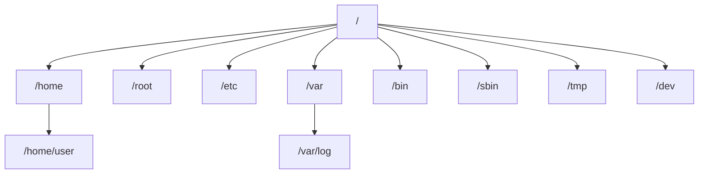

---
tags:
  - Utilisation d'une distribution GNU/Linux
---

# Module 4 – Fichiers et dossiers sous Linux

!!! warning "Module en cours"
    Fait : les chemins, le FHS, la démo arborescence. **Prochaine étape : Manipuler des dossiers.**

!!! abstract "En bref"
    - Le répertoire personnel est dans **`$HOME`**.
    - `cd` pour se déplacer, `cd ..` pour remonter, `.` = le répertoire actuel.
    - Le **FHS** standardise l'arborescence : `/home`, `/etc`, `/var/log`, `/bin`…

## 1. Arborescence de fichiers : les chemins

- Le chemin du **répertoire personnel** d'un utilisateur est contenu dans la variable **`$HOME`**.
- **Chemin relatif** : part de **là où l'on se trouve**.

| Commande | Rôle |
|---|---|
| `cd` | Se déplacer dans les dossiers, un à un ou en écrivant le chemin complet |
| `cd ..` | Remonter au dossier précédent (enchaînable pour remonter plusieurs dossiers : `cd ../..`) |
| `.` | Le répertoire actuel : pour lancer un script (`./monscript.sh`) ou le préciser (`find . -name "*.txt"`) |

## 2. Arborescence de fichiers : le FHS

**FHS** (*Filesystem Hierarchy Standard*) : standardisation de l'arborescence Unix/Linux.

| Dossier | Contenu |
|---|---|
| `/home` | Dossiers de tous les utilisateurs, **sauf root** |
| `/root` | Répertoire de l'utilisateur root |
| `/media` | Pour connecter des médias (CD, USB) |
| `/mnt` | Pour connecter des partitions de disques |
| `/bin` | Commandes pour les utilisateurs |
| `/sbin` | Commandes pour root (super-admin) |
| `/opt` | Programmes installés manuellement |
| `/boot` | Fichiers de démarrage |
| `/dev` | Fichiers de liaison des périphériques (disque dur, clavier, écran…) |
| `/etc` | Paramètres du système |
| `/var` | Données variables (sites web, journaux…) |
| `/var/log` | Fichiers de journalisation du système |
| `/lib` | Librairies utiles aux exécutables de `/bin` et `/sbin` |
| `/tmp` | Fichiers temporaires |
| `/proc` | Répertoire virtuel des paramètres du noyau |
| `/sys` | Informations sur les périphériques et pilotes |

## 3. Manipuler des dossiers

*À venir.*

## 4. Lister des fichiers et dossiers (`ls`)

*À venir.*

## 5. Manipuler des fichiers

*À venir.*

## 6. Métacaractères

*À venir (dont « utiliser une expression plusieurs fois »).*

---

## Exercices

**Exercice 1** : tu es dans `/home/user/docs`. Comment remonter dans `/home` en une commande ?

??? success "Correction"
    `cd ../..`

**Exercice 2** : comment lancer le script `test.sh` situé dans le dossier courant ?

??? success "Correction"
    `./test.sh`

**Exercice 3** : où chercher les journaux du système ? Les paramètres du système ? Le dossier de root ?

??? success "Correction"
    `/var/log` · `/etc` · `/root`

**Exercice 4** : différence entre `/bin` et `/sbin` ? Entre `/media` et `/mnt` ?

??? success "Correction"
    `/bin` : commandes des utilisateurs · `/sbin` : commandes de root.
    `/media` : médias amovibles (CD, USB) · `/mnt` : partitions de disques.

**TP** (à venir) :

- [ ] TP manipulation de fichiers et dossiers
- [ ] TP métacaractères
